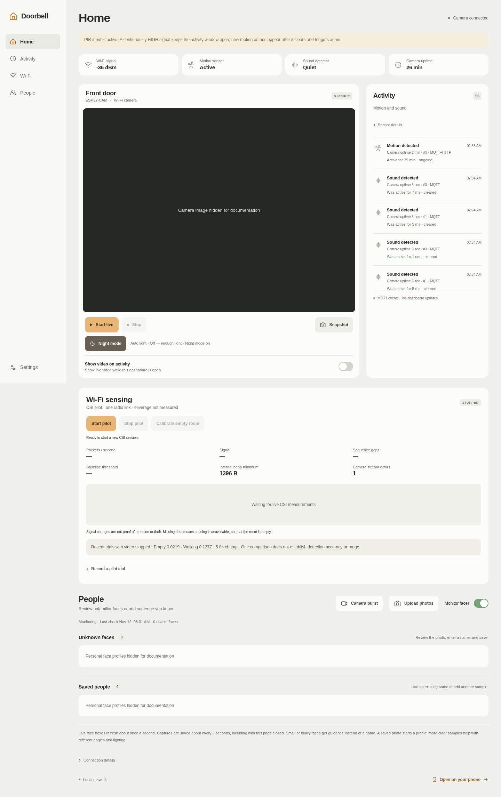
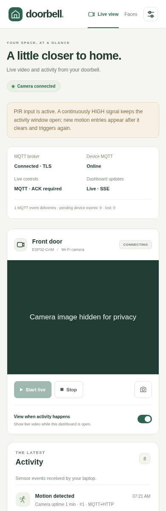
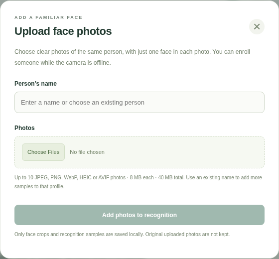
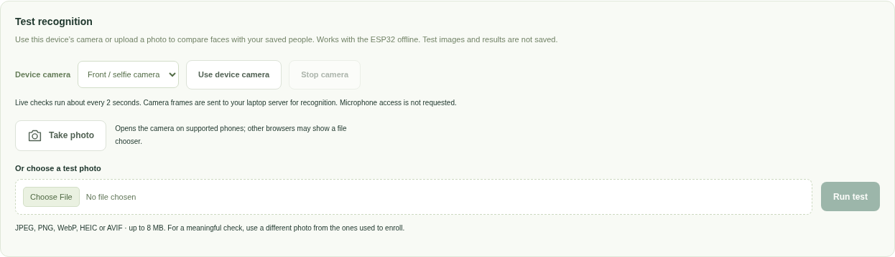

# ESP32 doorbell

A local smart doorbell with ESP32-CAM video, PIR and sound events, a phone-friendly
dashboard, and face recognition on a laptop using YuNet + SFace. MQTT over mutual
TLS carries device events and commands; HTTP carries MJPEG video.

## Dashboard screenshots

Captured from the running dashboard. The desktop and phone-width views show the
real device connected through MQTT, SSE updates, and saved sensor activity.
Camera imagery is masked for privacy; personal face photos and names are omitted.
The phone view uses a mobile browser viewport on the laptop.



| Phone layout | Photo enrollment |
| --- | --- |
|  |  |

Face recognition can be tested with an uploaded photo or the browser device's
camera without adding test images to the saved gallery:



## First setup after cloning

```bash
git clone https://github.com/yash-kalathiya/esp32-doorbell.git
cd esp32-doorbell
cp firmware/Doorbell/wifi_credentials.example.h firmware/Doorbell/wifi_credentials.h
```

Edit the local `wifi_credentials.h` with your own Wi-Fi details before compiling
or uploading firmware. That header, face databases/photos, test artifacts,
downloaded model weights, virtual environments and Wiki state are excluded from
Git. The model download script installs verified weights separately.

## Laptop dashboard

The dashboard runs on your laptop and works in a phone browser on the same
Wi-Fi. It relays live MJPEG video, offers Start/Stop and downloadable snapshots,
shows camera/sensor status, saves received motion/sound events locally, and
recognises enrolled faces using local YuNet + SFace models on the laptop.

1. Power the ESP32-CAM normally, with the IO0–GND upload jumper removed.
2. Connect the ESP32-CAM, laptop, and phone to the same Wi-Fi. Keep the laptop
   awake while using the dashboard.
3. Open `http://localhost:8000` on the laptop. Select the settings icon and enter
   the camera's current IP address (from Serial Monitor). The default is the
   last known home address, `192.168.12.140`.
4. Select **Start live**. Close any old direct ESP32 video stream first: the
   laptop maintains one connection to the camera and shares it with its viewers.
5. Select **Open on your phone** at the bottom of the dashboard. It shows the
   laptop's current LAN URL, such as `http://LAPTOP_WIFI_IP:8000`.

Both the laptop and camera IP addresses may change when Wi-Fi changes. The
phone opens the **laptop's** address; camera settings use the **ESP32's** address.
Guest/campus networks may prevent devices from reaching each other. The app
reports unavailable devices without displaying sample video or invented events.

The running user service lasts until stopped or the laptop reboots:

```bash
systemctl --user status esp32-doorbell-dashboard
systemctl --user stop esp32-doorbell-dashboard
```

To start it again:

```bash
systemd-run --user --collect --unit=esp32-doorbell-dashboard \
  --property=Restart=on-failure \
  --working-directory=/home/yash/Project/esp32-doorbell \
  /home/yash/Project/esp32-doorbell/scripts/run-dashboard.sh
```

For foreground development, stop the service first, then:

```bash
cd /home/yash/Project/esp32-doorbell
# Only needed when setting up on a new laptop:
uv venv .venv
uv pip install --python .venv/bin/python -r requirements.txt
.venv/bin/python scripts/download-face-models.py
./scripts/run-dashboard.sh
```

The server listens on `0.0.0.0:8000`. `PORT=8001 ./scripts/run-dashboard.sh`
selects a different port. Logs: `journalctl --user -u esp32-doorbell-dashboard`.

**Behavior and limits:** Start/Stop control the camera's shared manual-live
state. Stop also pauses viewing in the current browser; it does not cancel a
sensor's activity window. The activity toggle automatically displays available
video while this page is open. It does not record video. Face monitoring is a
separate server function with its own toggle (see below).
The sound module supplies digital threshold events, not microphone audio.

### Live face labels and sensor durations

Live video now displays face boxes with an enrolled name, **Unknown**, or a
quality hint (**Move closer** / **Improve lighting**). Detection and matching
run on the laptop using the already-received video frames; no face processing
or extra frame buffer is added to the ESP32. Boxes scale with the displayed
image, including phone layouts and letterboxing. Checks run about every three
seconds, so these are recent analysis results rather than per-frame tracking.
Boxes expire within five seconds of their source frame and clear when video
stalls, the device changes/reboots, or face monitoring is paused. Existing
recognition and enrollment thresholds remain in force; a quality hint does not
enroll or identify a low-quality face. Refresh the dashboard after updating it.

The Activity panel shows each pin's **HIGH/LOW state**, how long that level has
been observed, the last completed active duration, and accepted alert count for
the current boot. PIR is active **HIGH**; the current sound module is active
**LOW**, so a sound HIGH period is idle time. A continuously HIGH PIR produces
one motion activation until it clears and rises again. Sound alerts still use
the existing cooldown; short raw pin periods are not separate accepted alerts.

Upload the new `sensor-time-1` firmware for timing support; it includes the
`mqtt-mem-1` PSRAM optimizations. The laptop overlay works without this reflash.
Status includes `sensor_timing_version: 1` and `sensor_levels` with current
level duration, HIGH/LOW period counts, completed durations, current active
event IDs and accepted trigger counts. Raw period counts include the first
observed level at startup. PIR is sampled about every 20 ms, with the existing
100-ms stable-state check and 60-second warm-up. Sound edges are latched in
the GPIO ISR at millisecond resolution, with no networking, allocation or
logging in that ISR. Sub-millisecond periods display as **<1 ms**.

New events retain `type: motion|sound` and add `phase: triggered|cleared`.
The gateway pairs them by camera, device, boot and sensor using device uptime,
including clock rollover, duplicate transport deliveries and out-of-order
arrival. The UI shows one card per matched activation: **Active for … · ongoing**
or **Was active for … · cleared**. A new activation creates another card.
An unmatched clear remains visible with duration unavailable. Older events
without timing metadata are preserved and explicitly show that duration was
not recorded. Durations stop advancing when status becomes stale; boot IDs
prevent pairing events across a restart.

The NVS outbox record layout and 24-record capacity are preserved; the new
reader accepts the prior trigger-only records. Completed-period records also
consume outbox slots, so the visible loss counter still matters during long
offline periods. Broker configuration is unchanged. Validation includes 50
Python/native checks, C++ level/lifecycle/outbox tests, an isolated real-model
browser test, and a real local TLS broker test with a simulated device. The
timing firmware compiles for AI Thinker ESP32-CAM; physical timing and memory
margin still require its upload and a hardware check.

Fresh MQTT telemetry and events are the primary path after the MQTT firmware
is uploaded. Without a connected MQTT device, the server polls the existing
HTTP firmware every two seconds as a fallback; that path needs no reflash.
Received events are deduplicated using
camera address, device ID, boot ID, and event ID. The newest 2,000 events remain
in `.local-data/events.sqlite3` across server restarts; the newest 100 for the
selected camera appear in the feed. Feed times indicate **first received by
the laptop**, not the exact detection time. Camera uptime is shown separately.
Settings live in `.local-data/settings.json`. These files contain no Wi-Fi
credentials. The app is intended for a trusted LAN and has no user login.

Source: `server/app.py` (FastAPI relay), `web/` (responsive dashboard),
`scripts/run-dashboard.sh` (launcher).

### Local MQTT setup

The gateway uses Mosquitto on port **8883**, MQTT 3.1.1, QoS 1 and mutual TLS.
Each device has a client certificate and topic ACL; anonymous connections are
refused. The broker container mounts only its own identity/configuration, not
the CA signing key or the device/gateway private keys.

First-time setup (use the actual laptop Wi-Fi IP and the ESP32's `device_id`):

```bash
uv pip install --python .venv/bin/python -r requirements.txt
docker pull eclipse-mosquitto:2
.venv/bin/python scripts/setup-local-mqtt.py \
  --broker-ip LAPTOP_WIFI_IP --device-id ESP32_DEVICE_ID --write-firmware
.venv/bin/python scripts/run-mqtt-broker.py
systemctl --user restart esp32-doorbell-dashboard
```

The setup creates `.local-data/mqtt/` and the Git-excluded
`firmware/Doorbell/mqtt_credentials.h`. Compile and upload the sketch **once**
to enable MQTT on the ESP32; a server restart cannot update board firmware.
The topic identity must match the real board ID. The setup fails safely rather
than silently replacing an existing CA.

When changing from eduroam to the home network or hotspot, refresh the laptop
address before compiling/uploading:

```bash
.venv/bin/python scripts/setup-local-mqtt.py \
  --broker-ip NEW_LAPTOP_WIFI_IP --device-id ESP32_DEVICE_ID \
  --refresh-address --write-firmware
docker restart esp32-doorbell-mqtt
```

This preserves the CA/client identities, updates the broker certificate and the
firmware's default broker address, and does not print private keys. Upload the
rebuilt firmware when its broker address changes. Broker state and queued
messages are stored under `.local-data/mqtt/broker/data/`.

| Topic suffix under `doorbell/DEVICE_ID/` | Direction | Behavior |
| --- | --- | --- |
| `events` | ESP32 → gateway | QoS 1, not retained; deduplicated and committed to SQLite |
| `received` | Gateway → ESP32 | Application receipt after database commit |
| `state` | ESP32 → gateway | Retained QoS 0 heartbeat every 5 seconds; QoS 1 offline Last Will |
| `commands` | Gateway → ESP32 | Non-retained start/stop, unique command ID, boot binding and short expiry |
| `ack` | ESP32 → gateway | Application acknowledgement and resulting state |

The ESP32 keeps up to 24 pending events in a checksum-validated NVS outbox until
the gateway confirms storage. It retries unconfirmed events. Overflow drops the
oldest event and increments a visible loss counter. NVS-write failure is exposed
by `mqtt_outbox_persistent`; RAM delivery can continue, but power-loss retention
then cannot be assumed. NVS flash endurance under sustained triggering has not
been evaluated. Previously unconfirmed events retain their original boot IDs
after a reboot.

The broker's PUBACK is not treated as proof that the application saved an event.
Duplicate transport deliveries and duplicate HTTP fallback observations create
one event row, preserving its first receipt time. The `source` field shows
`mqtt`, `http`, or `mqtt+http`.

Commands are not confirmed to the UI until an application ACK arrives. Old-boot,
expired, retained or malformed commands are rejected; recent command IDs are
cached against duplicate execution. Historical retained-online state is not
proof of liveness: a fresh heartbeat is required, and state expires after
20 seconds. A Last Will or stale heartbeat moves the gateway to HTTP fallback.

The dashboard's health strip shows broker connection, device MQTT status,
selected control path and SSE live updates. Browsers receive changed status,
activity and face data over `/api/updates`; HTTP polling is a reconnect fallback.

This is the **local project milestone**. The broker transport is encrypted and
certificate-authenticated. The existing camera HTTP API and dashboard HTTP
listener remain LAN prototype interfaces without user login. Remote access,
browser HTTPS deployment, WebRTC and Wi-Fi CSI sensing are outside this milestone.

### Connection diagnostics firmware

The first diagnostic build identified itself as `mqtt-diag-1`; the memory
optimization build reports `"firmware_version":"mqtt-mem-1"` in the ESP32's
`/api/status` response and MQTT state. Upload the complete
`firmware/Doorbell/` sketch, including its new `doorbell_diagnostics.cpp` and
`.h` tabs. The newer `sensor-time-1` build includes those optimizations and
adds sensor timing. Neither build needs a broker configuration update.

After uploading, remove the IO0–GND jumper with power disconnected, restart the
board, and open `http://ESP32_IP/api/status`. The laptop's `/api/status` also
includes these fields under `camera` when it receives fresh device status.

| Field under `diagnostics` | What it helps distinguish |
| --- | --- |
| `reset_name`, `reset_reason` | Power-on, watchdog, panic or brownout reset reported by the chip |
| `memory` | Current/minimum free internal heap, largest free internal block and free PSRAM, in bytes |
| `wifi` | IP connection/disconnect counts and the last Wi-Fi disconnect reason |
| `mqtt` | Connection attempts, successful connections, disconnects and errors |
| `mqtt.last_error` | Error type, ESP/TLS codes, certificate flags, socket errno, broker code and internal heap sampled at the error |
| `camera` | Capture failures/durations, captures currently in progress, completed stream frames and stream errors |

The last MQTT error stays available after reconnecting; `last_error` is `null`
until an error occurs. Counts and error details reset on reboot and are scoped
to the response's `boot_id`. Event times are milliseconds since boot; `unix_time`
shows the board's wall clock for investigating certificate validity. Numeric
Wi-Fi reasons and TLS/certificate codes must be interpreted for the installed
ESP32 SDK, rather than treated as proof of a power or memory fault.

Serial Monitor at **115200 baud** also prints concise `[diag]` connection/error
lines. MQTT now starts after Wi-Fi obtains an IP, avoiding the observed startup
transport attempts before Wi-Fi was ready. The runtime MQTT timeout and TLS
certificate verification are unchanged. This build adds visibility; a fix for
the intermittent runtime disconnects or camera stalls has not been verified.

The native diagnostic serializer test uses fake hardware inputs with the real
cJSON library. It verifies retained error details across reconnect, capture
tracking, and message size, without claiming a physical-board result:

```bash
.venv/bin/python -m pytest -q tests/test_firmware_diagnostics.py
```

It requires `g++`, the system `libcjson` runtime and the ESP32 SDK cJSON header;
it skips if they are missing. `ESP32_JSON_INCLUDE` can select a different SDK
header directory. The Arduino firmware compile remains the target-board check.

### Internal memory optimization (`mqtt-mem-1`)

Physical testing of `mqtt-diag-1` caught internal free heap dropping to a
48-byte minimum while video and TLS ran together. TLS reported SSL/MPI allocation
failures, despite roughly 3.4 MB of unused PSRAM and zero recorded Wi-Fi drops.
The installed Arduino SDK builds mbedTLS with internal-memory allocation.

This build reserves more internal heap for networking by changing application
allocations:

- Install cJSON allocation hooks once, before camera/network tasks start, so
  JSON trees, keys, strings and serialized output use PSRAM. Boards without
  PSRAM retain an internal-memory path. On a PSRAM board, failed PSRAM JSON
  allocations are reported rather than silently consuming TLS's internal heap.
- Move the MQTT inbox's **8,224-byte item storage** to PSRAM, preserving all 16
  slots and the 511-byte incoming-message bound. Queue bookkeeping and task
  stacks stay internal; the queue is accessed only from tasks, never an ISR.
- Reduce MQTT input/output buffers from 2,048 to 1,024 bytes each, removing
  **2,048 bytes** of buffer demand. ESP-MQTT supports larger outgoing payloads
  through fragmentation. Application JSON remains bounded below 4 KiB for MQTT;
  HTTP event-history JSON keeps its existing variable size.
- Send replaceable retained heartbeats at QoS 0, directly from the worker,
  instead of accumulating stale state copies in the QoS 1 retry outbox. A lost
  heartbeat is replaced by the next one. Events, application receipts, commands,
  command ACKs and the offline Last Will retain their reliable delivery paths.

TLS verification, certificates, the durable sensor-event outbox, camera frame
size and task-stack sizes are preserved. JSON serialization uses a bounded
4-KiB PSRAM output buffer to avoid repeated growth/copy allocations. This trades
available PSRAM for internal-heap headroom; it does not claim every message uses
less total RAM. The changed buffers/queue account for about 10 KiB less dynamic
internal storage demand, before JSON and heartbeat-copy savings.

**Verification before uploading:**

| Check | Diagnostic build | Optimized build |
| --- | --- | --- |
| Arduino static globals | 76,224 bytes | 76,344 bytes |
| Arduino program storage | 1,292,897 bytes | 1,294,309 bytes |
| MQTT I/O buffer settings | 4,096 bytes combined | 2,048 bytes combined |
| MQTT inbox payload allocation | 8,224 internal bytes | 8,224 PSRAM bytes |
| Controlled native JSON internal allocation peak | 31,041 host bytes | 0 host bytes |
| Same native workload, combined allocation peak | 31,041 host bytes | 31,041 host bytes |

The 120-byte increase in static globals includes internal queue bookkeeping
previously allocated dynamically. Arduino's static-global figure does not
measure runtime heap consumption. The native comparison uses the real cJSON
library and firmware allocation hooks, simulated heap capabilities, three
concurrent 70-field JSON documents, and the same 4-KiB output buffer in both
passes. Host pointer sizes and allocator overhead differ from the ESP32; these
counts verify routing, not physical free heap. A further 2,000 threaded
create/serialize/free cycles left no live tracked allocations. Tests also cover
no-PSRAM operation, allocation failure and oversized-message rejection.

All 46 Python/native checks passed. An isolated real Mosquitto/mutual-TLS test
with a simulated device passed QoS 0 heartbeat delivery (including a state
larger than 1,024 bytes), QoS 1 event deduplication/receipts, command ACKs, broker
restart and offline Last Will. It does not test ESP32 transport fragmentation
or physical TLS/video stability. The firmware compiles for AI Thinker ESP32-CAM.

After uploading, check `firmware_version`, `diagnostics.memory.json_psram`,
`mqtt_inbox_psram`, and `mqtt_inbox_storage_bytes`. Compare the internal heap
minimum/largest block and disconnect/error counters during simultaneous video
and MQTT over several minutes. A new boot resets the heap minimum and counters.
**The optimized build's actual heap margin and disconnect rate still require
this physical upload/test.** No broker configuration change is needed.

Implementation references: [Espressif heap capabilities](https://docs.espressif.com/projects/esp-idf/en/release-v5.5/esp32/api-reference/system/mem_alloc.html),
[PSRAM restrictions](https://docs.espressif.com/projects/esp-idf/en/release-v5.5/esp32/api-guides/external-ram.html),
[ESP-MQTT publication, buffering and fragmentation](https://docs.espressif.com/projects/esp-idf/en/release-v5.5/esp32/api-reference/protocols/mqtt.html),
and [cJSON allocation hooks, preallocated printing and thread safety](https://github.com/DaveGamble/cJSON).

### Hardware validation

The MQTT firmware has been uploaded to the physical ESP32-CAM. Live checks on
November 11, 2026 confirmed an authenticated MQTT connection, a received motion
event, a cleared pending-event queue, and the video relay receiving frames.
After the `mqtt-mem-1` upload, a 60-second physical observation recorded zero
MQTT/Wi-Fi disconnects and zero camera errors. A 40-second video read received
1,013 frames (about 25 FPS), and both motion and sound events arrived via MQTT.
The recorded minimum internal heap was 2,944 bytes, versus the earlier 48-byte
minimum. This was a short stability check; restart recovery, longer operation,
recognition accuracy and physical `sensor-time-1` duration checks remain open.
Software and simulated-device checks do not establish those hardware results.

1. For a new setup, join the camera and laptop to the same home Wi-Fi/hotspot, update the broker
   address as above, then upload the sketch with the working USB wiring. Remove
   the IO0–GND upload jumper for normal operation.
2. Check that the dashboard shows **MQTT broker: Connected**, **Device MQTT:
   Online**, and **Dashboard updates: Live · SSE**. Device discovery should
   update the camera IP when its authenticated heartbeat arrives.
3. Wait for PIR warm-up. Confirm the PIR goes clear, then trigger fresh motion.
   Check one activity entry arrives with MQTT as its source. Repeated transport
   deliveries must not create duplicate entries. Validate sound polarity and
   threshold separately; an always-active input is not a successful sound test.
4. Start and stop live view. Confirm MQTT control is selected and the command is
   acknowledged; verify live video and a snapshot independently of telemetry.
5. Stop the project broker, trigger a fresh event and inspect
   `http://ESP_IP/api/status`: pending events should increase. Restart the broker;
   confirm the event arrives and the device pending count returns to zero.
6. Separately test power loss with an unconfirmed event, checking its persistence
   flag first. After reboot/reconnection, verify that event arrives once with
   its original boot ID. Measure actual video stability with TLS active.
7. Test recognition with enrolled and unenrolled people under the intended
   lighting, and record observed false matches/misses. Record a backup video of
   the actual working hardware demonstration after these checks pass.

Do not present the simulated-device integration test as physical sensor results.

### Name an unknown face

1. Connect the camera and laptop to the same Wi-Fi, then open **Faces** in the
   dashboard. **Monitor faces** is enabled by default.
2. Face monitoring checks images about every three seconds while the server
   runs, including with no browser open. It reuses current live-stream frames;
   when video is idle, it requests `/api/snapshot` from the ESP32 instead.
3. A usable unrecognised face appears as a photo under **Unknown faces**.
   Review that photo, type the person's name and select **Save person**.
4. The laptop saves its SFace embedding as an enrolled sample. Later camera
   images are compared against saved samples; no model training is required.
5. Enter an existing name on another unknown capture to add a sample to that
   profile. Name matching ignores case. More clear, varied samples can help.

Saved people and recent recognised captures appear below the unknown captures.
Background refresh preserves partially typed names. **Remove** deletes a
profile, its saved samples, and its associated face history. Future sightings
can then appear as unknown again.

### Enroll from uploaded photos

Select **Upload photos** in Faces, enter a name, choose photos and select
**Add photos to recognition**. **Add photos** on a saved profile opens the same
form with its name filled in. An existing name adds samples to that profile.
Enrollment works with the ESP32 offline and with background monitoring paused.

Upload up to 10 JPEG, PNG, WebP, HEIC/HEIF or AVIF images per request, up to 8 MB each and
40 MB total. Each photo must contain exactly one detected, usable face of the
intended person. The server checks the decoded format, fixes EXIF orientation,
strips metadata, and rejects images over 24 megapixels. Small/blurry faces,
group photos, corrupt files and unsupported formats receive individual reasons.
Usable photos are added even if other files fail; no empty profile is created
when all photos fail. The error banner includes the actual rejection reason.
JPEG-based MPO files, which can also use a `.jpeg` extension, are read using
their primary image. Other unsupported formats report their detected format.

Only face crops and embeddings are retained. Original uploads are closed after
processing and are not retained as enrollment files or logged. Uploaded photos
are not recorded as camera sightings. Profiles retain their newest 20 samples.

### Test recognition with a photo or this device's camera

The **Test recognition** panel compares a photo with saved profiles without
enrolling anyone, saving test images, or changing face/activity history. Choose
a test photo and select **Run test**, or choose **Use device camera** to preview
the camera attached to the device opening the page. **Front / selfie camera**
and **Back camera** request the corresponding camera when available.

Live tests send one sampled frame to the laptop about every two seconds, with
one request at a time. No microphone access is requested. **Stop camera**, leaving
the page, or hiding the page releases the camera and stops live checks. Results
show each usable face crop, its matched name or **Unknown**, and cosine similarity
(not a probability). Use different photos from enrollment to assess recognition
rather than testing only an exact copy of a saved image.

Browser camera access requires a secure context. On the laptop open
`http://localhost:8000/#faces` (or `http://127.0.0.1:8000/#faces`). A phone opening
`http://LAPTOP_IP:8000` cannot grant continuous live camera access. The panel
explains this and offers **Take photo**, which requests native photo capture on
supported mobile browsers; other browsers may show a file picker. Continuous
phone camera access needs the dashboard served over HTTPS with a certificate
trusted by that phone. HTTPS/certificate trust has not been configured by this
change. The page also works on an existing trusted HTTPS deployment.

**Monitor faces** pauses/resumes automatic image checks and is saved across
restarts. **Stop** in the video pane only controls live viewing; pause face
monitoring separately to stop background snapshots. The camera remains powered.

Models are downloaded once from the official OpenCV Zoo, with SHA-256 checks
against its Git LFS records. The YuNet model is MIT licensed; SFace is Apache
2.0 licensed (copies are in `models/`). Inference and enrollment run locally;
camera images and face profiles are not sent to an external recognition API.
If models are missing or invalid, the rest of the dashboard still works and
the face section reports the setup problem. Run the model download script and
restart the server to recover.

Face photos, normalised embeddings, names and observation timestamps are stored
in `.local-data/faces.sqlite3`. Retention is bounded to 100 unknown capture
groups, 300 recognised capture groups, 100 profiles and 20 samples per profile.
Captures are scoped to the configured camera address; profiles are shared across
camera address changes. Repeated similar unknown observations are grouped as a
review aid; these groups are not verified unique people or movement tracks.

Small faces (under 48 pixels) and blurry crops are skipped. Matching starts at
cosine similarity 0.50 with a 0.08 margin over the next profile; close or weak
matches remain unknown. These are initial operating thresholds, not calibrated
probabilities or a promised accuracy. Validate with real camera images, varied
lighting, and both enrolled and unenrolled people before relying on alerts.
This version has no liveness detection or automatic Wi-Fi identity tracking.

### Laptop API (port 8000)

These are the laptop endpoints; the firmware endpoints below run on the camera.

| Method | Path | Result |
| --- | --- | --- |
| GET | `/api/status` | Connection state, latest camera status, video relay status |
| GET | `/api/updates` | Server-sent `status`, `activity`, `faces` updates; heartbeat and reconnect support |
| GET | `/api/events` | Up to 100 saved events for the selected camera |
| POST | `/api/events` | Accept and deduplicate an optional firmware callback |
| GET | `/api/settings` | Configured camera base URL |
| PUT | `/api/settings` | Save `{"camera_url":"http://192.168.12.140"}` locally |
| GET | `/api/network` | Current laptop LAN URL for the phone |
| POST | `/api/live/start` | Request manual live view from the camera |
| POST | `/api/live/stop` | Clear the camera's manual-live request |
| GET | `/api/stream` | MJPEG shared from one camera stream |
| GET | `/api/snapshot` | Download a JPEG from the camera |
| GET | `/api/faces` | Model/monitoring state, unknown captures, people, recent matches |
| POST | `/api/faces/{id}/enroll` | Save `{"name":"Person name"}` for a reviewed capture |
| GET | `/api/faces/{id}/image` | Captured face thumbnail |
| GET | `/api/people/{id}/image` | Profile thumbnail |
| DELETE | `/api/people/{id}` | Remove a profile, samples and associated face captures |
| POST | `/api/people/upload` | Multipart `name` + repeated `files` fields; enroll usable photo samples |
| POST | `/api/faces/test` | Multipart `file`; return transient face-match results without saving |

`PUT /api/settings` also accepts `"face_monitoring": false` to pause automatic
face checks. Preserve `camera_url` when updating this setting.

### Dashboard checks

```bash
uv pip install --python .venv/bin/python -r requirements-dev.txt
.venv/bin/python -m pytest -q tests/test_dashboard.py tests/test_faces.py tests/test_mqtt.py
# With the dashboard running and Google Chrome installed:
.venv/bin/python scripts/check-dashboard.py
```

Protocol tests use a synthetic camera to verify cursor resets, deduplication,
history persistence, offline status, one upstream for multiple viewers,
connection cleanup, controls and snapshots. Browser checks exercise the running
UI at desktop/mobile widths and use clearly synthetic responses for live-video
controls. They do not establish real-camera or physical-phone streaming.

Face tests cover enrollment, subsequent matching, unknown/ambiguous results,
profile persistence/deletion, API validation, camera scoping, background
snapshot checks and reuse of the existing stream. The isolated real-model
browser test uses an OpenCV sample image and a temporary gallery:

```bash
mkdir -p artifacts
curl -fsSL -o artifacts/face-model-test.jpg \
  https://raw.githubusercontent.com/opencv/opencv/master/samples/data/lena.jpg
.venv/bin/python scripts/check-faces-ui.py
```

That test verifies the name-and-save flow and recognition of a subsequent
sample image, real-model upload enrollment, read-only photo tests, and sampled
live recognition through Chrome's simulated video camera. It also checks camera
release and the insecure-origin HTTPS guidance. It is not an evaluation of new
viewpoints, household accuracy, physical webcams or mobile browser permissions.
No test identities or sample images are inserted into the running gallery.

MQTT integration testing uses a real Mosquitto container, fresh test identities,
an isolated database and a simulated device. It tests TLS client authentication,
QoS 1 delivery, application receipts, deduplication, start/stop ACKs, broker
restart recovery and Last Will offline detection:

```bash
.venv/bin/python scripts/check-mqtt.py
g++ -std=c++17 -Wall -Wextra -Werror tests/doorbell_delivery_test.cpp -o /tmp/doorbell-delivery-test
/tmp/doorbell-delivery-test
```

The integration script removes only its own temporary broker. It never sends
test events to the running household broker. The host C++ tests cover bounded
outbox overflow, reboot restoration/checksum validation, ACK ordering, duplicate
commands, stale boot IDs, expiry and uptime rollover. These do not validate
physical NVS behavior, TLS heap use or real GPIO wiring on the board.

## Current communication and Wi-Fi sensing path

The camera and laptop communicate over the same home LAN. **MQTT over TLS**
carries events, telemetry and commands when MQTT firmware is active. **HTTP over
TCP/IP** carries video/snapshots and remains the legacy/fallback control path.

| Data | Connection | Format |
| --- | --- | --- |
| Live camera video | Laptop GET `http://ESP_IP:81/api/stream` | MJPEG: successive JPEG images in an HTTP multipart response |
| Status and sensor events | MQTT TLS port 8883; HTTP `/api/status`, `/api/events` fallback | JSON |
| Snapshot | Laptop GET port 80 `/api/snapshot` | JPEG |
| Live controls | MQTT command + application ACK; HTTP port 80 fallback | JSON |
| Optional sensor callback | ESP32 POST to the configured laptop event URL | JSON over HTTP |
| Phone dashboard | Browser connects to laptop port 8000 | HTTP, SSE updates, relayed MJPEG |
| Device-camera recognition test | Browser POST `/api/faces/test` about every two seconds | Sampled JPEG frames in multipart form data |

There is no WebRTC, RTSP or CSI transport in the current camera firmware.
USB serial is used for uploading/debugging, not normal power-bank operation.

**CSI research is not enabled in this project yet.** Espressif documents CSI
support on the original ESP32 as well as newer ESP32 variants. The locally
installed ESP32 Arduino core 3.3.12 exposes `esp_wifi_set_csi_rx_cb`,
`esp_wifi_set_csi_config` and `esp_wifi_set_csi`; its ESP32 configuration has
`CONFIG_ESP_WIFI_CSI_ENABLED=1`. This establishes software capability, not
working capture or reliable sensing on this physical board.

An experiment on the current ESP32-CAM would add a bounded CSI callback queue
and a separate UDP sender, then measure actual received packet cadence, losses,
and camera performance with CSI off/on. Test empty-room and walking periods on
the home network before implementing occupancy decisions. The camera and laptop
must be reachable on the same LAN. No CSI firmware was flashed during this review.

For RuView compatibility, raw measurements need its ADR-018 binary framing.
Its sensing server receives node data on **UDP 5005** and offers processed
results over HTTP/WebSocket. Our laptop server could consume those results and
show a separate presence/motion panel. RuView's documented main node target is
ESP32-S3; its supplied S3 firmware is not a drop-in image for the ESP32-CAM.
A dedicated supported node is an alternative to porting capture on this board.

One radio link is mainly a presence/motion experiment. Multiple spatial links
and room calibration are needed to evaluate location/track separation. A Wi-Fi
motion event does not automatically identify the person seen by the camera.

References: [Espressif ESP-CSI](https://github.com/espressif/esp-csi),
[RuView node firmware and wire format](https://github.com/ruvnet/RuView/blob/main/firmware/esp32-csi-node/README.md),
[RuView live-data server](https://github.com/ruvnet/RuView/blob/main/docs/user-guide.md#esp32-s3-full-csi).

## Firmware upload

Open `firmware/Doorbell/Doorbell.ino` in Arduino IDE. Keep every file in that
sketch directory together. Select **AI Thinker ESP32-CAM**, choose the actual
USB serial port, and upload using the working USB-to-TTL wiring and IO0-to-GND
upload jumper. Remove that jumper with power disconnected after uploading.
Serial Monitor uses **115200 baud**. Wi-Fi settings live in the Git-excluded
`wifi_credentials.h`; use the example header when setting up a new checkout.
Do not paste passwords into logs or commit that local header.

## Sensor wiring

Disconnect power before wiring. Use a shared ground, preferably the power GND
beside 5V for the USB supply. Do not use the ambiguous corner GND/R pin.
Leave the microSD slot empty and do not initialize SD storage: GPIO13/14 are
shared with the SD interface.

| Sensor | Sensor pin | ESP32-CAM / supply |
| --- | --- | --- |
| HC-SR501 PIR | VCC | regulated 5V |
| HC-SR501 PIR | GND | common GND |
| HC-SR501 PIR | OUT | IO13 / GPIO13 |
| Four-pin sound detector | + | 3V3, provided the module supports 3.3V operation |
| Four-pin sound detector | G | common GND |
| Four-pin sound detector | D0 | IO14 / GPIO14 |
| Four-pin sound detector | A0 | leave disconnected |

ESP32 signal pins are 3.3V logic. Do not feed a 5V sound output into IO14.
The code reads a digital noise threshold, **not microphone audio**. Verify the
sound module's voltage specification before connecting it. For the usual LM393
module, adjust the potentiometer until its threshold LED reacts to a clap.
`doorbell_config.h` contains sensor enable switches, pins, active polarity and
timing. The default D0 trigger is LOW; change `DOORBELL_SOUND_ACTIVE_LOW` to
`false` if the module asserts HIGH. Unconnected sensor pins have pull resistors;
the firmware can be uploaded before the sensors are attached.

PIR motion is ignored for the first **60 seconds** after sensor initialization;
sound input settles for 2 seconds. Motion HIGH must be stable for 100ms.
Sound interrupts only latch a flag; processing happens in a sensor task, with
at most one sound event per 3 seconds. Sensors continue running while Wi-Fi
reconnects or the laptop is unavailable.

## API v1

Replace `ESP_IP` with the address printed in Serial Monitor after each network
change. Control and JSON endpoints use port **80**. MJPEG uses port **81**.
This is a local-network prototype; these endpoints have no authentication.

| Method | URL | Result |
| --- | --- | --- |
| GET | `http://ESP_IP/api/status` | Wi-Fi, sensor readiness, activity window, stream clients, event/callback counters |
| GET | `http://ESP_IP/api/snapshot` | One JPEG image on demand |
| POST | `http://ESP_IP/api/live/start` | Set manual live request; return status |
| POST | `http://ESP_IP/api/live/stop` | Clear manual request; return status |
| GET | `http://ESP_IP:81/api/stream` | MJPEG while manual viewing or sensor activity is active; 409 if idle |
| GET | `http://ESP_IP/api/events?after=0` | Retained sensor events and next cursor |
| GET | `http://ESP_IP/api/config` | Current optional event-delivery URL |
| POST | `http://ESP_IP/api/config` | Save `{"event_url":"http://LAPTOP_IP:8000/api/events"}` in NVS |

The control server is separate from the stream server, so stop/status calls
can be serviced while video is streaming. Use one upstream stream connection
from the laptop server and distribute its frames there. Do not depend
on the ESP32 serving multiple simultaneous stream viewers.

PIR or sound opens a **30-second activity window**; further activity extends it.
PIR staying HIGH keeps that window open. Manual viewing remains on until stopped.
Stopping manual viewing does not cancel an active motion/sound window. When
both are inactive, the API stream ends. The camera stays initialized and Wi-Fi
stays connected; stopping a stream is not deep sleep or physical camera power-off.

The original camera page at `/`, `/capture`, `/status`, `/control` and
`:81/stream` still work. The original `:81/stream` is a direct manual view until
the client disconnects and is not controlled by `/api/live/stop`. The laptop
integration should use the new `:81/api/stream` endpoint.

## Laptop integration after uploading

No laptop server is required for the current camera page or event polling.
Until an event URL is configured, the firmware makes no outbound event requests.

For a manual test from a laptop on the same network:

```bash
curl -X POST http://ESP_IP/api/live/start
# Open http://ESP_IP:81/api/stream in a browser.
curl -X POST http://ESP_IP/api/live/stop
curl 'http://ESP_IP/api/events?after=0'
```

Once the laptop server exists, set its address without another firmware upload:

```bash
curl -X POST http://ESP_IP/api/config \
  -H 'Content-Type: application/json' \
  -d '{"event_url":"http://LAPTOP_IP:8000/api/events"}'
```

The callback URL survives power loss. Clear it with `{"event_url":""}`.
Use a trusted LAN HTTP endpoint; HTTPS and credential-bearing URLs are not
supported in this prototype. Configuration contains no Wi-Fi passwords.

Each callback POST is a JSON event, for example:

```json
{"device_id":"esp32cam-example","boot_id":"1234abcd","id":1,"type":"motion","uptime_ms":61000}
```

The laptop must return a **2xx** response to acknowledge an event. Failed
delivery is retried after 5 seconds with bounded HTTP timeouts. Delivery is
at least once: deduplicate by `(device_id, boot_id, id)`. The ring retains the
newest **24 events in RAM**, not video or historical events across reboots.
An extended outage can overwrite old events; status reports lost callback
events and polling reports `lost_before_cursor`.

For polling, track `boot_id` and `next_after`; reset the cursor to zero when
the boot ID changes. Poll about once per second if using events to open video.
A cursor beyond the newest ID returns `reset_required: true` and retained events.
The same ring is used for push and polling; neither consumes the other view.
`uptime_ms` is time since ESP32 startup, not UTC. Check event age and current
`stream_allowed` before treating a delayed event as current activity.

The ESP32 makes video available but does not independently record or upload
video when a sensor fires. The laptop server polls events, relays the MJPEG
stream and runs face recognition; video recording is not implemented.

## Verification boundary

Host tests exercise activity timing, sensor warm-up, overlap with manual viewing,
sound cooldown, millisecond-clock rollover and event-ring retention/cursors:

```bash
g++ -std=c++17 -Wall -Wextra -Werror tests/doorbell_logic_test.cpp -o /tmp/doorbell-logic-test
/tmp/doorbell-logic-test
```

Compile the sketch with the installed ESP32 core:

```bash
arduino-cli --config-file /home/yash/.arduinoIDE/arduino-cli.yaml compile \
  --fqbn esp32:esp32:esp32cam --jobs 2 firmware/Doorbell
```

These checks do not validate real GPIO polarity, wiring, Wi-Fi failover, NVS,
HTTP callbacks, HTTP stream cancellation or camera operation on the board.
After uploading, confirm `/api/status`, wait for `pir_ready`, trigger each sensor,
inspect `/api/events`, then test manual start/stop and activity-window expiry.
Leave the callback unset until the laptop server is implemented and tested.
