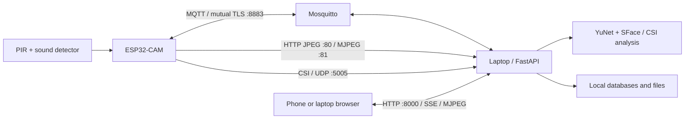

# ESP32 Doorbell

A local smart doorbell with live video, face recognition, motion and sound
activity, and an experimental Wi-Fi sensing pilot.

The **ESP32-CAM** captures images and reads sensors. A **laptop server** handles
face recognition, storage and CSI analysis. Open the dashboard on a phone or
laptop connected to the same Wi-Fi.

[Demo](#demo) · [Features](#features) · [Architecture](#architecture) ·
[Quick start](#quick-start) · [Wiring](#wiring) · [Documentation](#documentation)

## Demo

**[Watch or download the demo video →](docs/demo/demo_video.mp4)**

2 min 45 sec · 720p · MP4 · 18.3 MB. If GitHub does not play it, choose
**Download raw file**. The video is also included when you clone the repository.

| Time | What happens |
| --- | --- |
| 00:00–00:43 | Hardware overview, camera connection and sensor activity. |
| 00:44–01:07 | Live ESP32 video with face recognition overlays. |
| 01:08–01:39 | Review an unknown face, enter a name and save a new person. |
| 01:40–02:08 | Start the CSI pilot and view incoming Wi-Fi measurements. |
| 02:09–02:45 | Calibrated signal graph, armed watch, possible-intrusion entry and acknowledgement. |

Times are approximate. This edited recording demonstrates the workflow; it is
not a continuous stability test or a controlled CSI accuracy evaluation.

## Features

| Feature | What you can do |
| --- | --- |
| **Live camera** | Start/stop video, take snapshots and view on a phone. |
| **Face recognition** | See names or unknown-face boxes; enroll people from an ESP32 burst or uploaded photos without retraining. |
| **Sensor activity** | Review motion/sound incidents, active durations and cleared or fault states. |
| **Low-light support** | Use automatic 50% illumination in low light and a separate Night mode image profile. |
| **Wi-Fi sensing** | Calibrate and plot CSI changes from the router–ESP32 radio link. |
| **Security watch** | Arm/disarm an experimental sustained-change rule and acknowledge saved incidents. |
| **Local storage** | Keep profiles, activity, settings and incidents on the laptop. |

**Video and CSI run separately** to stay within ESP32 memory limits. The sound
sensor supplies digital threshold events; it does not record audio.

## Architecture



All network paths use the same home LAN. The ESP32 joins **2.4 GHz Wi-Fi**;
the laptop and phone can use either band if both share the same LAN.

| Traffic | Protocol |
| --- | --- |
| Events, device status and live commands | MQTT 3.1.1 over mutual TLS; HTTP fallback |
| Video and snapshots | HTTP MJPEG and JPEG |
| CSI measurements | Binary I/Q frames over UDP; processed on the laptop |
| Dashboard | HTTP, server-sent events and relayed MJPEG |

The phone opens the **laptop's IP address**. Camera settings use the
**ESP32's IP address**. USB is needed for upload/debugging; normal operation can
use a power bank connected to 5V and GND.

## Quick start

### Use the existing setup

1. Power the ESP32 with the **IO0–GND upload jumper removed**. Keep the laptop
   gateway and broker running.
2. Connect your phone to the same LAN. Use **Open on your phone** on the laptop
   dashboard to get its address, such as `http://LAPTOP_WIFI_IP:8000`.
3. Open **Home → Start live**. Use **People** for face enrollment and **Activity**
   for sensor history. Close any browser tab streaming directly from the ESP32.

### Run the dashboard on another laptop

The commands below use a Linux shell and Python 3. Docker is needed for the
full MQTT setup; Arduino IDE or CLI is needed to upload firmware.

```bash
git clone https://github.com/yash-kalathiya/esp32-doorbell.git
cd esp32-doorbell
python3 -m venv .venv
.venv/bin/python -m pip install -r requirements.txt
.venv/bin/python scripts/download-face-models.py
./scripts/run-dashboard.sh
```

Open **`http://localhost:8000`** on that laptop. In **Settings**, enter the
ESP32's current address. Use `http://LAPTOP_WIFI_IP:8000` on your phone and keep
the laptop awake.

The model downloader installs verified YuNet and SFace weights. A fresh clone
has no saved people or activity. HTTP status/event/control fallback works
without MQTT provisioning; the full setup requires
[matching broker and device identities](docs/technical-guide.md#local-mqtt-setup).
The already-flashed board does not automatically trust a new laptop's CA.

### Prepare and upload firmware

```bash
cp firmware/Doorbell/wifi_credentials.example.h firmware/Doorbell/wifi_credentials.h
```

1. Edit the local header with your **2.4 GHz Wi-Fi** details. It supports a
   primary and an optional second network.
2. Open **`firmware/Doorbell/Doorbell.ino`** in Arduino IDE, keeping **every file
   in that sketch folder** together.
3. Select **AI Thinker ESP32-CAM**, the correct serial port and **Huge APP**.
   The verified Arduino ESP32 core version is **3.3.12**.
4. Connect **IO0 → GND**, reset and upload. Then disconnect power, remove the
   upload jumper and restart normally. Serial Monitor uses **115200 baud**.

For MQTT, obtain the actual `device_id` from `http://ESP_IP/api/status`, follow
[local MQTT setup](docs/technical-guide.md#local-mqtt-setup), then rebuild/upload
with the generated local header. A new board can first run Wi-Fi-only firmware
to obtain its ID. Restart the dashboard after provisioning.

## Wiring

Disconnect power before changing wires. Use a common ground and leave the
microSD slot empty: **IO13 and IO14 are used by the sensors**.

| Connection | ESP32-CAM pin |
| --- | --- |
| Regulated 5V supply | **5V** |
| Supply ground | **GND** beside 5V |
| PIR VCC / GND / OUT | **5V / GND / IO13** |
| Sound + / G / D0 | **3V3 / GND / IO14** |
| Sound A0 | Leave disconnected |
| USB adapter TX / RX | **U0R / U0T** |
| Upload jumper | **IO0 → GND**, only for uploading |

The sound module must support 3.3V operation; ESP32 signal pins use 3.3V logic.
On the project's verified USB cable, **red = 5V, black = GND, green = TX,
white = RX**. Wire colors are not universal.

[Full wiring notes and sensor polarity →](docs/technical-guide.md#sensor-wiring)

## Using the dashboard

- **Home:** start live video, take a snapshot or select Night mode. Enable
  **Show video on activity** to display sensor-triggered video while the page
  is open. Automatic activity windows last a fixed 30 seconds.
- **Activity:** check how long a sensor was active and whether it cleared.
  Sound needs two seconds of quiet to rearm; a prolonged input is flagged.
- **People:** enable **Monitor faces**, review unknown captures and save a
  name. **ESP32 camera burst** takes eight photos from the ESP32; **Upload
  photos** accepts JPEG, PNG, WebP, HEIC/HEIF and AVIF. Review per-photo results.
- **Wi-Fi:** stop video and turn off automatic viewing before starting the
  pilot. Keep the router and ESP32 fixed; calibrate an empty room for 60
  seconds. **Arm away** has a 15-second exit delay. Disarm and stop CSI before
  returning to video.

The CSI pilot has a ten-minute lease. A new session or a radio placement change
requires fresh calibration. CSI detects signal changes, not a person's identity.

<details>
<summary>Dashboard screenshots: desktop, phone and photo enrollment</summary>


| Phone layout | Photo enrollment |
| --- | --- |
|  |  |

These screenshots show earlier dashboard captures; the demo video shows the
latest presentation. Personal faces are omitted from these still images.

</details>

## Project structure

```text
firmware/Doorbell/     Complete Arduino sketch
server/app.py         FastAPI gateway and video relay
server/faces.py       Face detection, enrollment and matching
server/csi.py         CSI receiver, calibration and analysis
server/security.py    Experimental security-watch rules
web/                  Dashboard HTML, CSS and JavaScript
scripts/              Setup, launch and verification tools
tests/                Automated software and native checks
docs/                 Demo, screenshots and technical guide
```

Runtime data stays in `.local-data/`. Wi-Fi/MQTT credential headers, private
keys, face databases, downloaded models and test artifacts are excluded from Git.
The demo video is included explicitly for teammate review.

## Project status

The latest recorded software run passed **89 automated tests**, with separate
browser checks. Physical checks exercised video/MQTT, CSI acquisition, power-loss
event replay, broker recovery and laptop-service restart.

| Area | Remaining work or boundary |
| --- | --- |
| PIR | Prolonged HIGH was observed; its electrical cause remains unresolved. |
| Wi-Fi recovery | Physical shared-router outage/reassociation test is pending. |
| CSI | Fixed-device walking and non-human disturbance validation are pending; no measured coverage or accuracy claim. |
| Security watch | Experimental local alerts; CSI does not identify or track named people. |
| Deployment | Trusted LAN, laptop awake; dashboard/camera HTTP has no login. No remote notifications or continuous video recording. |

[Measured results and validation boundaries →](docs/technical-guide.md#reliability-update-reliable-1)

## Documentation

| Guide | Contents |
| --- | --- |
| [Technical guide](docs/technical-guide.md) | Detailed behavior, firmware history and engineering notes |
| [MQTT setup](docs/technical-guide.md#local-mqtt-setup) | Broker provisioning, certificates, topics and event delivery |
| [Face enrollment](docs/technical-guide.md#camera-burst-orientations-and-sample-count) | Bursts, image orientation, upload limits and sample selection |
| [CSI pilot](docs/technical-guide.md#csi-pilot-with-the-existing-esp32-cam) | Calibration, trial recording and experimental limits |
| [API reference](docs/technical-guide.md#laptop-api-port-8000) | Laptop routes; [ESP32 routes](docs/technical-guide.md#api-v1) |
| [Development checks](docs/technical-guide.md#dashboard-checks) | Software, browser and simulated-device verification |
